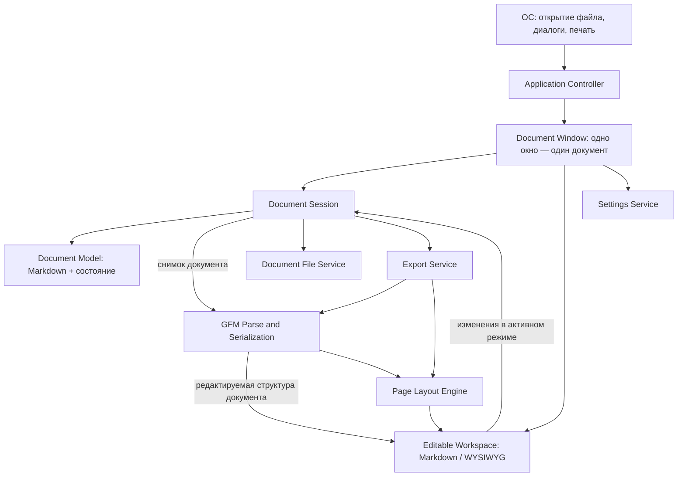

# Архитектура Markpad

Статус: проектное предложение на основе требований из [README.md](./README.md) и [AGENTS.md](./AGENTS.md). Исходный код и инфраструктура сборки пока отсутствуют; детали, зависящие от конкретных библиотек, нужно подтвердить при реализации.

## Цели и принципы

- Настольный редактор Markdown на C++20 и Qt для Windows и Linux.
- Single Document Interface (SDI): одно окно приложения отображает ровно один документ; вкладок с несколькими документами в одном окне нет.
- Поддержать три редактируемых режима одного документа: редактирование Markdown-исходника, WYSIWYG с непрерывной раскладкой и WYSIWYG с автоматической многостраничной раскладкой.
- Использовать GitHub Flavored Markdown (GFM) как диалект документа. WYSIWYG-редактирование и форматирование должны сохранять поддерживаемую семантику GFM; функции форматирования, невыразимые в GFM, не предлагать.
- Сохранять Markdown как переносимый источник документа; изменения в любом режиме отражаются в общей модели и доступны в остальных режимах.
- Предпочесть модульный монолит: процессы и сетевые сервисы не нужны для заявленного локального сценария.
- Разделять доменную логику и UI; использовать Qt и платформенные API за пределами ядра приложения.

Численные требования по размеру документов, времени обновления редактируемого представления и доступности пока не заданы. Архитектура не должна блокировать UI на обычных операциях; тяжёлый разбор, преобразование и экспорт можно выполнять в рабочем потоке, если измерения покажут необходимость.

## Структура компонентов

### Ответственность и границы

| Компонент | Ответственность |
|---|---|
| **Application Controller** | Создание окон, обработка аргументов командной строки и системных запросов открыть файл, управление жизненным циклом приложения. Не содержит правил парсинга и компоновки документа. |
| **Document Window** | Qt-окно для одного документа: меню, панели, команды и рабочая область с переключаемым режимом редактирования. В окне не размещать вкладки документов. |
| **Document Session** | Состояние открытого документа: текущая модель, путь, признак изменений, операции открытия/сохранения/экспорта и защита от потери несохранённых изменений. |
| **Document Model** | Текущий GFM-исходник и необходимые метаданные. Не зависит от виджетов; предоставляет версионированные снимки для преобразования и редактирования. |
| **Editable Workspace** | Переключает редактор между Markdown-исходником, WYSIWYG с непрерывной раскладкой и WYSIWYG со страницами. Все режимы изменяют одну сессию/модель. |
| **GFM Document Pipeline** | Разбирает GFM в редактируемое дерево документа и сериализует изменения обратно в GFM. Не исполняет встроенный HTML, скрипты или активный контент. |
| **Page Layout Engine** | Вычисляет геометрию страниц, поля и размещение блоков для пагинированного режима и PDF-экспорта. Непрерывный WYSIWYG-режим не показывает границы страниц. |
| **Document File Service** | Чтение и запись Markdown-файлов, кодировка и диагностика ошибок. Сохранение должно быть устойчиво к частичной записи, насколько это поддерживает выбранная платформенная реализация. |
| **Export Service** | HTML-экспорт из безопасного представления; PDF-экспорт из общей раскладки страниц. Возвращает явный результат операции или ошибку. |
| **Settings Service** | Настройки приложения в конфигурационном файле, значения по умолчанию и валидация при загрузке. Повреждённые настройки не должны ломать запуск. |

Модули могут быть обычными библиотечными границами внутри одного процесса; не вводить отдельные процессы и абстрактные интерфейсы на каждую функцию без причины.

## Потоки данных и интерфейсные контракты

1. В Markdown-режиме пользователь редактирует исходный GFM-текст; в WYSIWYG-режимах пользователь редактирует его структурное представление. Все операции обновляют одну `Document Session`/`Document Model` и признак несохранённых изменений.
2. GFM Pipeline преобразует снимок документа между исходным текстом и редактируемым деревом. Изменения WYSIWYG сериализуются в GFM; неподдерживаемые или невыразимые элементы форматирования нельзя молча терять или добавлять.
3. Pipeline возвращает типизированное дерево документа и диагностику, а не исполняемый HTML. Санитизация/ограничение активного содержимого обязательны на границе недоверенного Markdown/HTML.
4. Page Layout Engine преобразует дерево документа и `PageSetup` в `PageLayout`. Пагинированный WYSIWYG-режим и PDF-экспорт используют общую компоновку.
5. HTML-экспорт сериализует безопасное представление GFM; относительные ресурсы и ссылки обрабатываются по явно определённой политике, а не загружаются бесконтрольно.
6. Файловая операция сообщает путь, итоговый статус и диагностическую ошибку. Команда Save/Export не снимает признак изменений и не показывает успех до успешного завершения операции.

Логические контракты (без привязки к конкретному C++ API):

- `DocumentSession::replaceSource(text) -> ChangeResult`
- `DocumentSession::open(path) -> Result<DocumentSnapshot, FileError>`
- `DocumentSession::save(path) -> Result<void, FileError>`
- `GfmDocumentPipeline::parse(snapshot) -> Result<EditableDocument, ParseDiagnostics>`
- `GfmDocumentPipeline::serialize(editedDocument) -> Result<MarkdownText, SerializeDiagnostics>`
- `PageLayoutEngine::layout(editedDocument, PageSetup, LayoutMetrics) -> PageLayout`
- `ExportService::exportHtml(editedDocument, options, path)` / `exportPdf(pageLayout, options, path) -> Result<void, ExportError>`

Тип `Result` здесь означает явное значение успеха/ошибки, а не предписывает конкретную библиотеку. Долгие операции должны принимать снимок документа; результат фоновой задачи применяется только если он всё ещё соответствует актуальной версии документа, иначе устаревшее представление отбрасывается.

## SDI: поведение окон

- Каждое окно связано ровно с одной `Document Session`; несколько документов открываются в нескольких независимых окнах одного процесса.
- **New** создаёт новое пустое окно. **Open** повторно использует только чистое пустое окно; если активное окно уже содержит документ, выбранный файл открывается в новом окне. Это безопасное поведение по умолчанию, предотвращающее случайную замену документа.
- Открытие файла из ОС создаёт отдельное окно документа либо использует чистое пустое окно.
- Закрытие окна с несохранёнными изменениями предлагает сохранить, отказаться от изменений или отменить закрытие. Отказ/ошибка сохранения не закрывает окно.
- Меню и команды документа относятся к документу текущего окна. Никакое состояние одного окна не должно менять документ в другом.
- Окна могут совместно использовать неизменяемые сервисы и настройки приложения, но не редактируемую модель документа.

## Многостраничная раскладка и экспорт

- Базовая раскладка автоматическая: последовательное содержимое размещается на страницах с учётом размера бумаги и полей.
- Пагинированный WYSIWYG-режим и PDF должны использовать один `PageLayout`; HTML отражает безопасное содержимое и стили, но не обязан визуально повторять бумажные границы, если это не требуется критериями приёмки.
- До выбора движка рендеринга необходимо проверить переносы заголовков, длинных абзацев, таблиц, изображений и блоков кода, а также воспроизводимость между Windows и Linux.
- Визуальные различия шрифтов/метрик между ОС возможны; зафиксировать используемые шрифты/поведение и критерии допустимого расхождения при реализации.

## Настройки и хранение

- Конфигурационный файл содержит настройки приложения и значения по умолчанию, например тему и параметры редактора.
- UI sketch включает настройку Auto Save, но не задаёт периодичность, целевой файл или поведение после сбоя. Эти параметры нужно определить до реализации; автосохранение не должно незаметно перезаписывать исходник или отменять защиту от потери данных.
- Размер бумаги и поля могут быть настройками по умолчанию; хранение индивидуального макета конкретного документа не определено требованиями. Рекомендуется не встраивать непредусмотренные метаданные в обычный Markdown без отдельного решения.
- Определить платформенные пути хранения конфигурации и версионирование схемы при реализации. Неверные/неизвестные значения валидируются, сообщаются диагностически и заменяются безопасными значениями по умолчанию.

## Инструменты и зависимости

### Зафиксированный профиль разработки

- **Windows:** MSYS2 UCRT64, GCC, CMake и Ninja. UCRT64 — основной локальный toolchain; не смешивать его библиотеки с CLANG64 или MSYS.
- **UI и системные функции:** Qt 6. Начать с Qt Widgets и Qt PrintSupport; использовать `QPdfWriter`/Qt printing для PDF spike до рассмотрения дополнительного PDF SDK.
- **Тесты:** Qt Test для unit/integration тестов и CTest для запуска набора из CMake.
- **Форматирование/анализ:** `clang-format` обязателен при наличии исходников; `clang-tidy` — дополнительная проверка, не обязательная на каждой быстрой сборке.
- **CI:** GitHub Actions: Windows runner с MSYS2 UCRT64 и Ubuntu runner с GCC. Для Linux использовать Qt 6, CMake и Ninja, доступные в runner/package manager; зафиксировать версии и установочные шаги в workflow.
- **Установка:** пользователь управляет установкой MSYS2 пакетов. Архитектурный документ не подразумевает самостоятельной установки или изменения окружения разработчика.
- **Лицензии:** проверить лицензии выбранных Qt modules и приложить требуемые notices/информацию при распространении. MIT-лицензия приложения не отменяет лицензионные обязательства сторонних библиотек.

### Открытый технический spike: GFM/WYSIWYG

На момент составления документа пакет `cmark-gfm` не найден в каталоге пакетов MSYS2; доступный пакет `cmark` заявлен как CommonMark и не является автоматической заменой GFM. До выбора библиотеки проверить:

1. Сборку одного GFM-парсера на Windows/UCRT64 и Linux.
2. Наличие разборки в редактируемую модель и сериализатора обратно в GFM либо объём адаптера, который придётся поддерживать самим.
3. Сохранение неприменённых/неподдержанных синтаксических узлов без потери содержимого при переключении режимов.
4. Лицензию, сопровождение и поведение на тестовых документах: таблицы, задачи, зачёркивание, fenced code, HTML и некорректный ввод.

Не подключать CommonMark parser с выключенными/отсутствующими GFM extensions под видом поддержки GFM. Зафиксировать выводы spike и выбранную зависимость в task-файле до реализации WYSIWYG.

## Качество, безопасность и тестирование

- **Надёжность:** ошибки открытия/сохранения/экспорта видимы пользователю; закрытие с несохранёнными правками защищено от потери данных.
- **Безопасность:** GFM, встроенный HTML, ссылки, изображения и пути считаются недоверенными. Встроенные скрипты и активный контент не выполняются; загрузка внешних ресурсов ограничена и согласована для WYSIWYG-режимов и экспорта.
- **Поддерживаемость:** компоненты имеют явные обязанности; библиотека парсинга/экспорта изолирована за небольшим адаптером, если это помогает заменить её или тестировать.
- **Производительность:** измерять на длинных документах; при необходимости вынести разбор/экспорт из UI-потока и отбрасывать устаревшие результаты.
- **Тесты ядра:** GFM parse-edit-serialize, сохранение семантики между режимами, санитизация, правила пагинации, обработка ошибок и сериализация проверяются без создания окон, где возможно.
- **Интеграционные тесты:** переключение режимов с несохранёнными изменениями, открытие/сохранение, диалоги закрытия, несколько окон, экспорт и настройки.
- **Платформенные проверки:** сборка и ключевые тесты для Windows и Linux; визуальные проверки пагинации на обеих платформах.
- **Ревью:** координатор проверяет diff и границы безопасности; независимые инструменты проверки используются только если они реально доступны в среде.

## Архитектурные решения и открытые вопросы

Начальный план реализации, статусы задач и зависимости ведутся в [docs/tasks/README.md](./docs/tasks/README.md). Детальные исполнительские постановки находятся в одноимённых карточках `task_<NNN>.md`; карточки `Draft` нельзя передавать на реализацию до закрытия блокирующих решений.

### ADR-001: модульный монолит и SDI

- **Статус:** принято как проектное направление.
- **Решение:** одно Qt desktop-приложение; одно окно — один документ; несколько документов представлены отдельными окнами. Внутри процесса разделить UI, сессию/модель документа, Markdown pipeline, раскладку, файлы, экспорт и настройки.
- **Причины:** соответствует локальному редактору и требованию SDI; сохраняет независимость документов и позволяет повторно использовать общие сервисы без сложностей межпроцессного взаимодействия.
- **Последствия:** менеджер окон и жизненный цикл документа обязательны; синхронизация нескольких документов/вкладки не входят в модель. Все режимы редактируют одну модель; преобразование между GFM и WYSIWYG должно сохранять поддерживаемую семантику. Пагинированный режим и PDF используют общую раскладку.
- **Альтернативы:** MDI или вкладки не соответствуют SDI; отдельный процесс на документ усложняет запуск и обмен системными запросами без заявленной потребности.

### Открытые решения для подтверждения перед соответствующей реализацией

1. **Open в занятом окне:** в этом предложении файл открывается в новом окне. Подтвердить, подходит ли это поведению продукта; альтернатива — заменить документ в текущем окне после обязательного подтверждения сохранения.
2. **Страничные настройки:** определить, являются ли они только глобальными настройками по умолчанию или должны сохраняться отдельно для каждого документа.
3. **Встроенный HTML и внешние ресурсы:** определить, разрешать ли безопасно санитизированный HTML и какие схемы ссылок/источников изображений поддерживаются.
4. **Рендеринг:** выбрать версии Qt и GFM/PDF-компоненты после проверки лицензий, поддержки Windows/Linux, редактируемости WYSIWYG и согласованности пагинированного режима с PDF.
5. **Auto Save:** определить периодичность и цель сохранения (исходный файл или восстановительная копия), а также поведение при закрытии и ошибке записи.
